# RIR-API

API REST para procesamiento y analisis de respuestas al impulso segun la norma ISO 3382.


## Descripcion

RIR-API es el trabajo practico de Senales y Sistemas (UNTREF, 2C 2026): una API REST
(FastAPI) con la cadena completa de procesamiento acustico, desde la generacion de senales
de excitacion hasta el calculo de parametros acusticos (EDT, T20, T30, D50, C80) segun
ISO 3382-1.

- Consigna, especificaciones y ruta del TP: <https://maxiyommi.github.io/signal-systems/trabajo_practico/ruta/>
- API de referencia de la catedra (Swagger UI): <https://rir-api.onrender.com/docs>


## Integrantes

| Nombre | Legajo | Rol |
| --- | --- | --- |
| Fernandez, Alejo | 75508 | Responsable de DSP / Procesamiento de Señales |
| Garcia Nizza, Ignacio | 67573 | Responsable de QA & Testing |
| Prieto, Julian | 57543 | Responsable de Backend & API |
| Luque, Mauricio | 38650 | Responsable de DevOps & Documentación |


## Instalación y ejecución

Para ejecutar el proyecto localmente, primero se debe clonar el repositorio:

```bat
git clone https://github.com/alejo1129/rir-api.git
cd rir-api
```

Luego se instalan las dependencias del proyecto:

```bat
uv sync
```

Para iniciar la API:

```bash
uv run uvicorn app.main:app --reload
```

Una vez iniciada, la API queda disponible en:

- API: `http://localhost:8000`
- Swagger UI: `http://localhost:8000/docs`
- Health check: `http://localhost:8000/health`

Para ejecutar los tests: 

```bash
uv run pytest -v
```


## Arquitectura del Proyecto

```mermaid
flowchart TB
    C["Cliente<br/>Swagger · frontend · script"]

    subgraph R["app/routers/ · FastAPI"]
        RH["health.py<br/>GET /health"]
        RAH["audio_http.py<br/>wav_response<br/>uploaded_file"]
        RS["signals.py<br/>POST /signals/pink-noise<br/>POST /signals/sine-sweep<br/>POST /signals/synthetic-ir"]
        RF["filters.py<br/>POST /filters/single-band"]
        RU["utils.py<br/>POST /utils/smoothing<br/>POST /utils/schroeder<br/>POST /utils/lundeby"]
        RA["acoustics.py<br/>POST /acoustics/parameters"]
    end

    subgraph SC["app/schemas/ · Pydantic"]
        SR["responses.py<br/>HealthResponse<br/>BandAnalysisResponse"]
        SS["signals.py<br/>PinkNoiseRequest<br/>SineSweepRequest<br/>SyntheticIRRequest"]
        SU["utils.py<br/>SmoothingRequest<br/>SchroederResponse<br/>LundebyResponse"]
    end

    subgraph SV["app/services/"]
        PN["pink_noise.py<br/>generate_pink_noise"]
        SW["sine_sweep.py<br/>generate_sine_sweep_pair"]
        IO["audio_io.py<br/>play_and_record"]
        SIG["signal_utils.py<br/>load_audio<br/>generate_synthetic_ir<br/>get_impulse_response<br/>logarithmic_scale_conversion"]
        FIL["filter.py<br/>filter_single_band"]
        AC["acoustic_parameters.py<br/>apply_smoothing<br/>apply_schroeder_integral<br/>linear_regression<br/>calculate_parameters_from_ir<br/>apply_lundeby"]
    end

    L["Librerías de procesamiento<br/>NumPy · SciPy · sounddevice · soundfile"]

C -->|"GET /health"| RH
RH -->|"response_model"| SR
RH -->|"JSON"| C

C -->|"datos JSON"| RS
RS -->|"valida request"| SS
RS -->|"generate_pink_noise"| PN
RS -->|"generate_sine_sweep_pair"| SW
RS -->|"generate_synthetic_ir"| SIG
RS -->|"wav_response"| RAH
RS -->|"WAV"| C

C -->|"WAV + parámetros"| RF
RF -->|"uploaded_file / wav_response"| RAH
RF -->|"load_audio"| SIG
RF -->|"filter_single_band"| FIL
RF -->|"WAV"| C

C -->|"datos JSON"| RU
RU -->|"valida request"| SU
RU -->|"apply_smoothing / apply_schroeder_integral"| AC
RU -->|"JSON"| C

C -->|"RI en WAV"| RA
RA -->|"uploaded_file"| RAH
RA -->|"load_audio"| SIG
RA -->|"filter_single_band (interno)"| FIL
RA -->|"calculate_parameters_from_ir"| AC
RA -->|"response_model"| SR
RA -->|"JSON: EDT, T20, T30, D50, C80"| C

PN --> L
SW --> L
IO --> L
SIG --> L
FIL --> L
AC --> L
```




## Estructura del proyecto

```
rir-api/
├── app/
│   ├── __init__.py
│   ├── main.py
│   ├── settings.py
│   ├── routers/
│   │   ├── __init__.py
│   │   ├── health.py
│   │   ├── audio_http.py
│   │   ├── signals.py
│   │   ├── filters.py
│   │   ├── acoustics.py
│   │   └── utils.py
│   ├── schemas/
│   │   ├── __init__.py
│   │   ├── signals.py
│   │   ├── utils.py
│   │   └── responses.py
│   └── services/
│       ├── __init__.py
│       ├── pink_noise.py
│       ├── sine_sweep.py
│       ├── audio_io.py
│       ├── signal_utils.py
│       ├── filter.py
│       └── acoustic_parameters.py
├── tests/
│   ├── data/
│   ├── test_placeholder.py
│   ├── test_generacion.py
│   ├── test_procesamiento.py
│   ├── test_analisis.py
│   └── test_api.py
├── data/
├── docs/
├── .github/
│   └── workflows/
│       └── ci.yml
├── .gitignore
├── pyproject.toml
├── uv.lock
└── README.md
```

Cada milestone expone lo que construye: los routers y schemas de `signals` se agregan en M1
(y suman `synthetic-ir` en M2), los de `filters` en M2 y los de `acoustics` y `utils` en M3
(ver los `TODO` en `app/main.py`).


## Estrategia de trabajo con Git:

Para organizarnos mejor durante el proyecto vamos a trabajar de la siguiente manera:

- `main` será la rama principal y no se modificará directamente.
- Para cada tarea o Issue se creará una rama aparte desde Git local.
- Las ramas tendrán nombres relacionados con la tarea, por ejemplo: `feature/ruido-rosa`.
- Cuando una tarea esté terminada se abrirá un Pull Request hacia `main`.
- Cada Pull Request deberá ser revisado y aprobado por otro integrante antes de hacer el merge.
- Para los commits utilizaremos Conventional Commits, por ejemplo: `feat:`, `fix:`, `docs:` o `test:`.


## Milestones y entregas (2C 2026)

| Milestone | Entrega | Tag | Evaluacion |
|-----------|---------|-----|------------|
| **M0 · El plano** (arquitectura) | mie 7/10 (asincronica, por Slack/GitHub) | — | Seguimiento, sin nota |
| **M1 · Generacion de senales** | mie 28/10 (en clase) | `v0.1.0` | Seguimiento, sin nota |
| **M2 · Procesamiento de la RI** | mie 4/11 | `v0.2.0` | Seguimiento, sin nota |
| **M3 · Producto final** + presentacion oral | mie 18/11 | `v1.0.0` | **Nota del TP: 60 % M3 + 40 % oral** |

- No hay informe escrito: la validacion de resultados va en una seccion **"Validacion"** de
  este README.
- **`AI_LOG.md`** en la raiz del repositorio es **obligatorio** (sin nota propia, pero sin
  `AI_LOG.md` M3 no se considera completo): registren el uso de herramientas de IA durante
  todo el proyecto.
- Detalle de cada milestone: <https://maxiyommi.github.io/signal-systems/trabajo_practico/ruta/>

### M0 · El plano

- [x] Repositorio del grupo creado a partir del template, con los docentes como colaboradores.
- [x] `uv sync`, `uv run uvicorn app.main:app --reload` y `uv run pytest` funcionan.
- [x] README con integrantes y roles, instalacion, estructura y branching strategy.
- [x] Diagrama de arquitectura (Mermaid o draw.io) con todos los modulos de M1, M2 y M3.
- [x] Al menos 10 issues con labels (`milestone-1`, `milestone-2`, `milestone-3`) y asignados.

### M1 · Generacion de senales (`v0.1.0`)

- [x] `generate_pink_noise()` en `app/services/pink_noise.py` (Voss-McCartney recomendado).
- [x] `generate_sine_sweep_pair()` (sweep + filtro inverso) en `app/services/sine_sweep.py`.
- [x] `play_and_record()` en `app/services/audio_io.py`.
- [x] Endpoints `POST /api/v1/signals/pink-noise` y `POST /api/v1/signals/sine-sweep` (devuelven WAV),
      con sus schemas en `app/schemas/signals.py`.
- [x] Tests de `tests/test_generacion.py` y los de M1 en `tests/test_api.py` pasando;
      graficas de validacion en [`docs/m1/evidencia.md`](docs/m1/evidencia.md).


#### Ejemplos de uso desde terminal

Generación de ruido rosa:

```bash
curl -X POST "http://127.0.0.1:8000/api/v1/signals/pink-noise" ^
  -H "Content-Type: application/json" ^
  -d "{\"duration\":5,\"sample_rate\":44100}" ^
  -o pink_noise.wav
```

Generación de sine sweep:

```bash
curl -X POST "http://127.0.0.1:8000/api/v1/signals/sine-sweep" ^
  -H "Content-Type: application/json" ^
  -d "{\"duration\":5,\"start_freq\":20,\"end_freq\":20000,\"sample_rate\":44100,\"inverse\":false}" ^
  -o sine_sweep.wav
```

Para obtener el filtro inverso del sweep, se utiliza el mismo endpoint cambiando `"inverse":false` por `"inverse":true`.

### M2 · Procesamiento de la RI (`v0.2.0`)

- [x] `load_audio()`, `generate_synthetic_ir()`, `get_impulse_response()` y
      `logarithmic_scale_conversion()` en `app/services/signal_utils.py`.
- [x] `filter_single_band()` en `app/services/filter.py`.
- [x] Endpoints `POST /api/v1/signals/synthetic-ir` y `POST /api/v1/filters/single-band`
      (recibe un WAV subido).
- [x] Tests de `tests/test_procesamiento.py` y los de M2 en `tests/test_api.py` pasando.

#### Endpoints implementados en M2

##### Generación de respuesta al impulso sintética

`POST /api/v1/signals/synthetic-ir`

Genera una respuesta al impulso sintética a partir de la duración, los valores de T60 por banda de frecuencia y la frecuencia de muestreo. Devuelve un archivo WAV.

Ejemplo de solicitud:

```bash
curl -X POST "http://127.0.0.1:8000/api/v1/signals/synthetic-ir" -H "Content-Type: application/json" -d "{\"duration\":2.4,\"t60_values\":{\"1000\":0.8},\"sample_rate\":44100}" -o synthetic_ir.wav
```

##### Filtrado de banda

`POST /api/v1/filters/single-band`

Recibe un archivo WAV y una frecuencia central (`center_freq`). Devuelve el audio filtrado en formato WAV.

Ejemplo de solicitud:

```bash
curl -X POST "http://127.0.0.1:8000/api/v1/filters/single-band" -F "file=@synthetic_ir.wav" -F "center_freq=1000" -o filtered.wav
```

#### Validación

Se realizaron pruebas de validación para las funcionalidades implementadas en M2.

##### 1. Generación de respuesta al impulso sintética

Se generó una respuesta al impulso con un T60 objetivo de 0,8 s en la banda de 1.000 Hz.

Resultados:

- T60 objetivo: **0,800 s**
- T60 estimado: **0,844 s**
- Error relativo: **5,5 %**

El resultado presenta una buena concordancia con el valor configurado.

##### 2. Recuperación mediante deconvolución

Se comparó una respuesta al impulso de referencia con la respuesta recuperada mediante deconvolución de un sine sweep.

- Correlación obtenida: **1,0000**

La correlación demuestra una coincidencia prácticamente perfecta entre ambas respuestas en esta simulación.

##### 3. Filtro de banda de octava IEC 61260

Se evaluó la respuesta en frecuencia de un filtro centrado en 1.000 Hz.

| Frecuencia | Ganancia |
| ---: | ---: |
| 500 Hz | -52,21 dB |
| 707,11 Hz | -6,02 dB |
| 1.000 Hz | 0,00 dB |
| 1.414,21 Hz | -6,02 dB |
| 2.000 Hz | -52,55 dB |

La respuesta presenta una ganancia máxima en la frecuencia central, una atenuación de aproximadamente 6 dB en los límites de la banda y una atenuación superior a 50 dB en las frecuencias adyacentes.

##### 4. Resultado de las pruebas automatizadas

La suite completa de pruebas se mantiene en verde.

Estado actual verificado:

- **80 tests aprobados**
- **0 tests fallidos**
- **0 XFAIL pendientes**

El estado puede verificarse ejecutando:

```bash
uv run pytest -q
```

Las evidencias detalladas, las gráficas y la metodología de validación se encuentran en [`docs/m2/evidencia.md`](docs/m2/evidencia.md).

### M3 · Producto final (`v1.0.0`)

- [x] `apply_smoothing()`, `apply_schroeder_integral()`, `linear_regression()` y `calculate_parameters_from_ir()` implementadas en `app/services/acoustic_parameters.py`.
- [x] Endpoints `POST /api/v1/acoustics/parameters`, `POST /api/v1/utils/schroeder` y `POST /api/v1/utils/smoothing` implementados.
- [x] Tests de análisis y API aprobados: 80 tests pasando (95 % de cobertura).
- [x] Sección "Validación" documentada en este README y registro [`AI_LOG.md`](AI_LOG.md) incorporado.
- [x] Comparación final de resultados por banda con software de referencia y presentación oral.
- [x] Publicación de la versión final `v1.0.0`.
- [ ] (Opcional) `apply_lundeby()`.

#### Endpoints implementados en M3

`POST /api/v1/acoustics/parameters` — Calcula EDT, T10, T20, T30, D50 y C80 por banda de octava:

```bash
curl -X POST "http://127.0.0.1:8000/api/v1/acoustics/parameters" -F "file=@docs/m2/audio/ri_t60_largo_stairwell.wav"
```

`POST /api/v1/utils/schroeder` — Calcula la curva de decaimiento energético (EDC) en dB:

```bash
curl -X POST "http://127.0.0.1:8000/api/v1/utils/schroeder" -F "file=@docs/m2/audio/ri_t60_largo_stairwell.wav"
```

`POST /api/v1/utils/smoothing` — Calcula la envolvente suavizada (`hilbert` o `moving_average`):

```bash
curl -X POST "http://127.0.0.1:8000/api/v1/utils/smoothing" -F "file=@docs/m2/audio/ri_t60_largo_stairwell.wav" -F "method=hilbert" -F "window_ms=10"
```

#### Validación de M3

Se validó el cálculo de parámetros acústicos ISO 3382 sobre una RI sintética multibanda (ajuste lineal R² = 0,99618) y sobre la RI real de escalera (`ri_t60_largo_stairwell.wav`):

| Banda (Hz) | T60 objetivo (s) | T30 calculado (s) | Error relativo |
| ---: | ---: | ---: | ---: |
| 125 | 1,80 | 1,896 | 5,3 % |
| 250 | 1,70 | 1,748 | 2,8 % |
| 500 | 1,60 | 1,573 | 1,7 % |
| 1000 | 1,50 | 1,527 | 1,8 % |
| 2000 | 1,30 | 1,306 | 0,5 % |
| 4000 | 1,10 | 1,101 | 0,1 % |

Las gráficas y tablas completas se encuentran en [`docs/m3/evidencia.md`](docs/m3/evidencia.md) y [`docs/m3/resultados_parametros.csv`](docs/m3/resultados_parametros.csv).

## Tests

La suite automatizada cubre las funcionalidades implementadas desde M0 hasta M3.

- **80 tests aprobados**
- **0 tests fallidos**
- **Cobertura total del proyecto: 95 %**
  - `app/routers/acoustics.py`: 100 %
  - `app/routers/utils.py`: 88 %
  - `app/services/acoustic_parameters.py`: 95 %

No existen marcas `xfail` activas en los tests actuales.

```bash
uv run pytest -q
uv run pytest -q --cov=app
```

`play_and_record()` se testea automáticamente con un *mock* de `sounddevice` en CI. Además, se realizó una validación con hardware real utilizando una interfaz Focusrite USB Audio: entrada Analogue 1 + 2 por el canal 1, salida Altavoces por 2 canales, `fs = 48000 Hz`, `blocksize = 0` (automático / PortAudio) y un pre-roll de 0,5 s. La prueba utilizó un sine sweep logarítmico de 20 Hz a 20 kHz durante 5 s, obteniendo un pico de -6,02 dBFS, un RMS de -22,57 dBFS y 0 muestras con clipping (ver [`docs/m1/evidencia.md`](docs/m1/evidencia.md)).

## Linter y formato

```bash
uv run ruff check app/ tests/          # verificar estilo
uv run ruff check --fix app/ tests/    # corregir lo automatico
uv run ruff format app/ tests/         # formatear
```

El CI (`.github/workflows/ci.yml`) corre `ruff check`, `ruff format --check` y `pytest --cov=app` en cada push a `main` y en cada pull request.

## Configuracion

`app/settings.py` define la configuracion con `pydantic-settings`. Cualquier valor se puede sobreescribir con variables de entorno con prefijo `RIR_` (por ejemplo `RIR_FS_DEFAULT=44100`) o con un archivo `.env` en la raiz (ignorado por git).

## Referencias

- ISO 3382-1:2009 — Acoustics — Measurement of room acoustic parameters.
- Farina, A. (2000). *Simultaneous measurement of impulse response and distortion with a swept-sine technique.* 108th AES Convention.
- Schroeder, M. R. (1965). *New method of measuring reverberation time.* JASA 37(3).
- [FastAPI](https://fastapi.tiangolo.com/) · [Pydantic](https://docs.pydantic.dev/) · [uv](https://docs.astral.sh/uv/)
