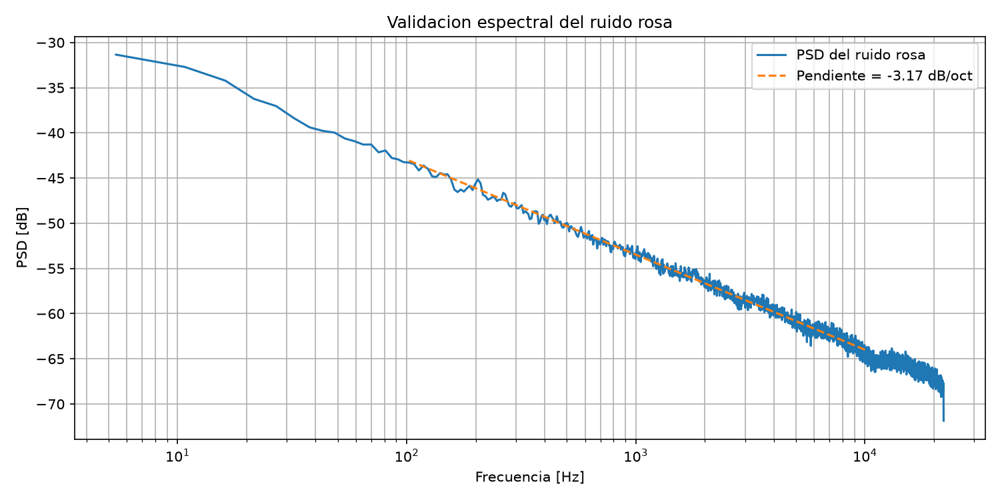
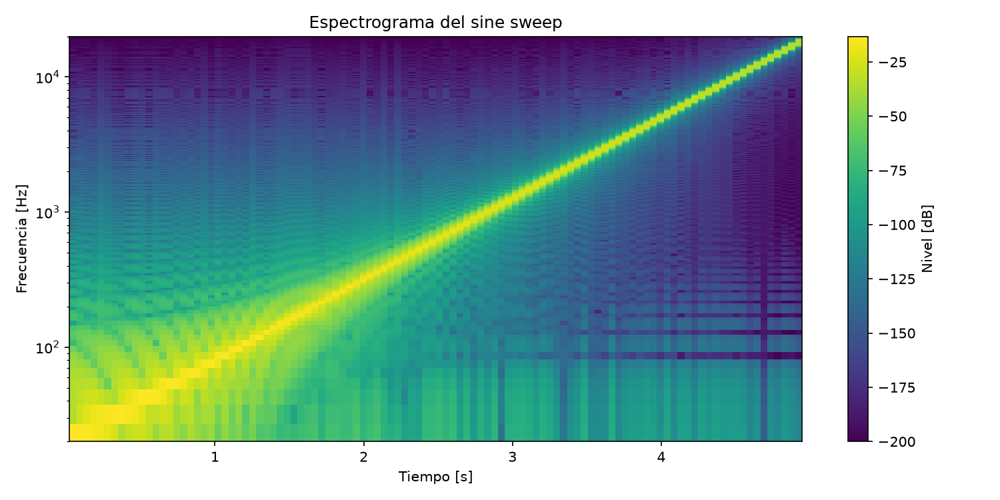
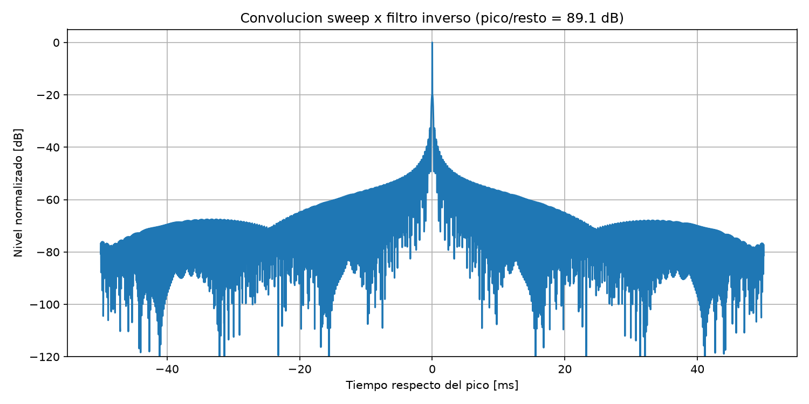
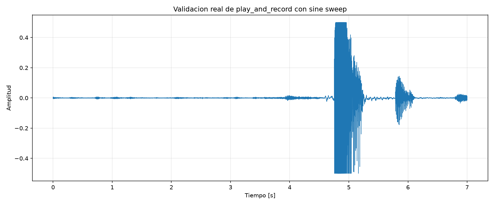

# Evidencias de validación — Milestone 1

Este documento reúne las validaciones realizadas sobre las funcionalidades implementadas en M1: generación de ruido rosa, generación de sine sweep y filtro inverso, y reproducción/grabación de audio.

## 1. Validación del ruido rosa

Se generó una señal de ruido rosa de 10 segundos a una frecuencia de muestreo de 44.100 Hz.

Para verificar su comportamiento espectral se calculó la densidad espectral de potencia mediante el método de Welch entre 100 Hz y 10 kHz.

La pendiente obtenida fue:

- Pendiente medida: **-3,17 dB/octava**

El resultado es consistente con el comportamiento esperado de un ruido rosa y se encuentra dentro del rango utilizado por los tests automáticos de M1.



---

## 2. Validación del sine sweep

Se generó un sine sweep logarítmico con los siguientes parámetros:

- Frecuencia inicial: **20 Hz**
- Frecuencia final: **20.000 Hz**
- Frecuencia de muestreo: **44.100 Hz**
- Duración: **5 s**

Se calculó el espectrograma de la señal para verificar que la frecuencia aumente progresivamente desde el extremo inferior hasta el superior del rango especificado.



---

## 3. Validación del filtro inverso

Se convolucionó el sine sweep generado con su filtro inverso mediante `scipy.signal.fftconvolve()`.

El resultado esperado es una señal aproximadamente impulsiva, con un pico claramente dominante respecto del resto de la señal.

Resultado obtenido:

- Relación pico/resto: **89,1 dB**

Los tests automáticos de M1 requieren una relación mínima de **60 dB**, por lo que el resultado supera ampliamente el criterio de validación.



---

## 4. Validación real de reproducción y grabación

La función `play_and_record()` fue validada utilizando hardware de audio real y un sine sweep logarítmico reproducido y grabado mediante una interfaz Focusrite.

### Configuración de audio

- Interfaz de audio: **Focusrite USB Audio**
- Entrada: **Analogue 1 + 2 (Focusrite)**, utilizando el **canal 1**
- Salida: **Altavoces (Focusrite)**, utilizando **2 canales**
- Frecuencia de muestreo: **48.000 Hz**
- Blocksize: **0 (automático / PortAudio)**
- Pre-roll: **0,5 s**

### Señal utilizada

- Tipo: **sine sweep logarítmico**
- Frecuencia inicial: **20 Hz**
- Frecuencia final: **20.000 Hz**
- Duración del sweep: **5 s**
- Nivel digital aplicado al sweep: **0,1**
- Duración total de grabación: **7 s**

### Resultado

- Muestras grabadas: **336.000**
- Pico registrado: **0,500061035**
- Pico registrado: **-6,02 dBFS**
- RMS registrado: **0,074422577**
- RMS registrado: **-22,57 dBFS**
- Muestras con clipping: **0**

La señal grabada presenta un nivel claramente útil y mantiene margen respecto del clipping. La medición confirma el funcionamiento real de `play_and_record()` utilizando la interfaz física, incluyendo el pre-roll de 0,5 s agregado antes de la reproducción.



Los resultados numéricos de esta prueba se encuentran en:

- `docs/m1/qa_play_and_record_real.txt`

La prueba puede repetirse mediante:

```bash
uv run python -m scripts.qa_play_and_record_real
```

---

## 5. Reproducibilidad

Las tres validaciones gráficas pueden regenerarse mediante:

```bash
uv run python -m scripts.generate_m1_evidence
```

El script utilizado se encuentra en:

`scripts/generate_m1_evidence.py`

Las mismas comprobaciones empleadas para generar estas evidencias están basadas en los criterios implementados en `tests/test_generacion.py`.