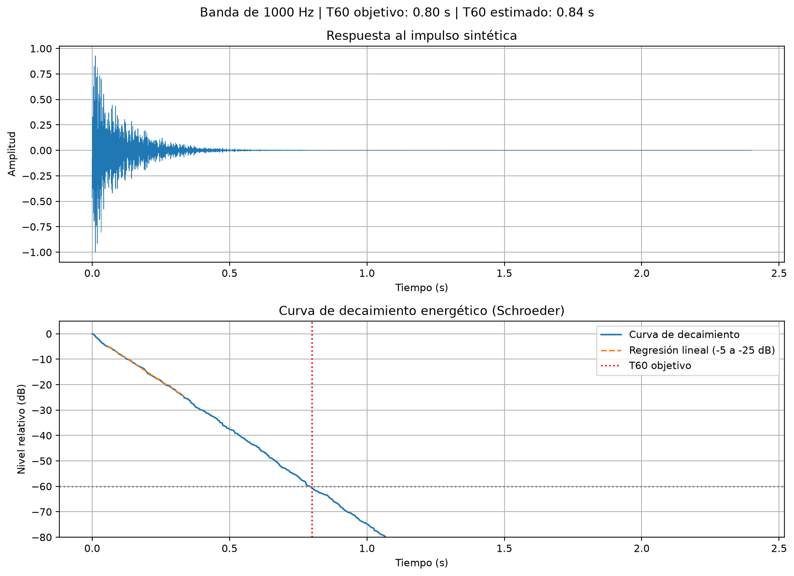
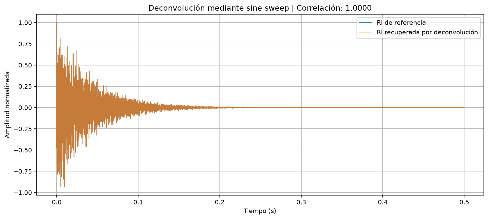
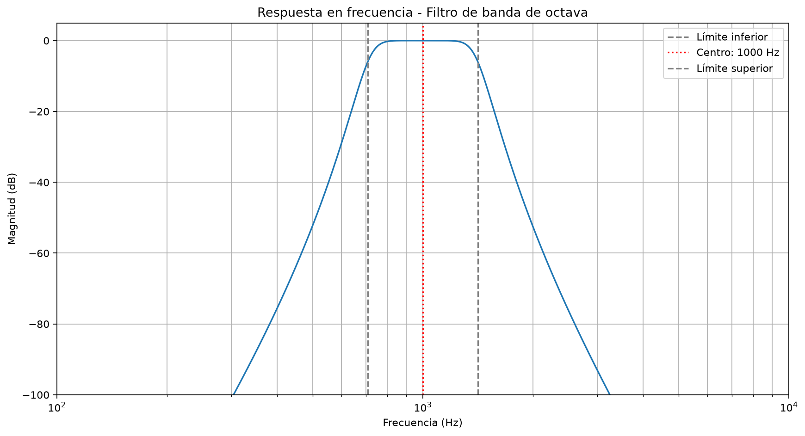
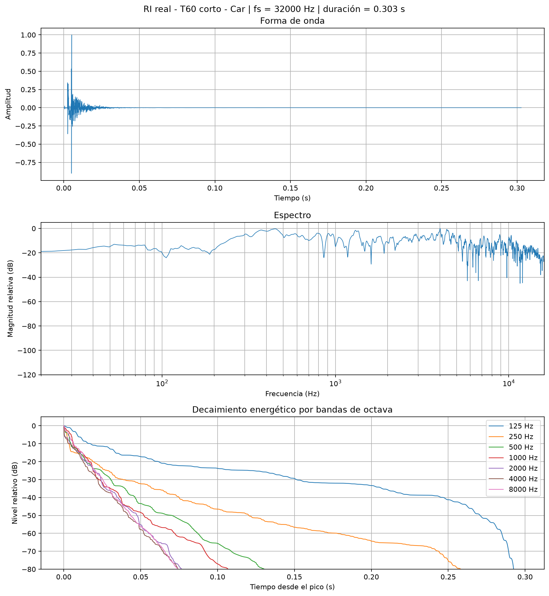
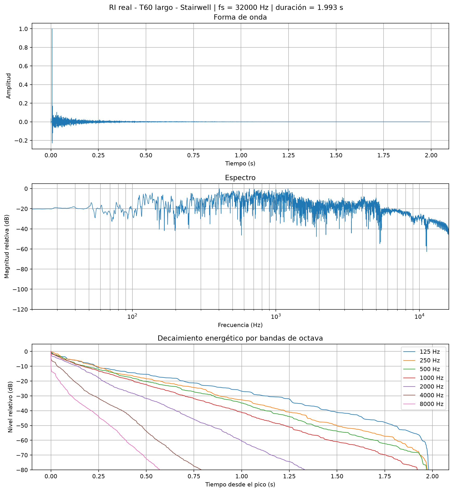
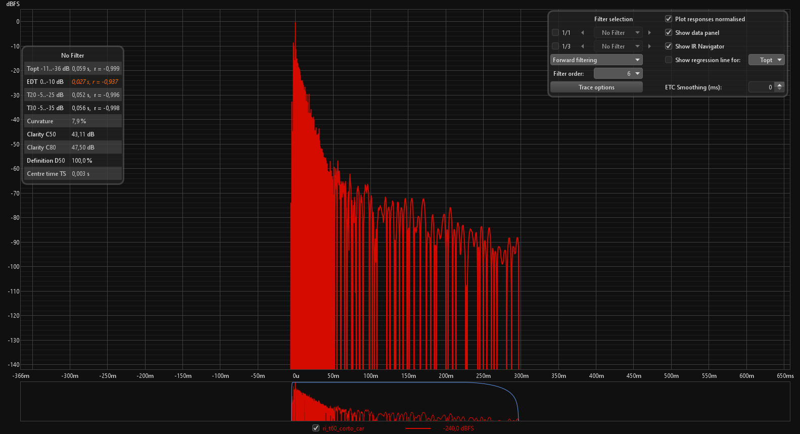
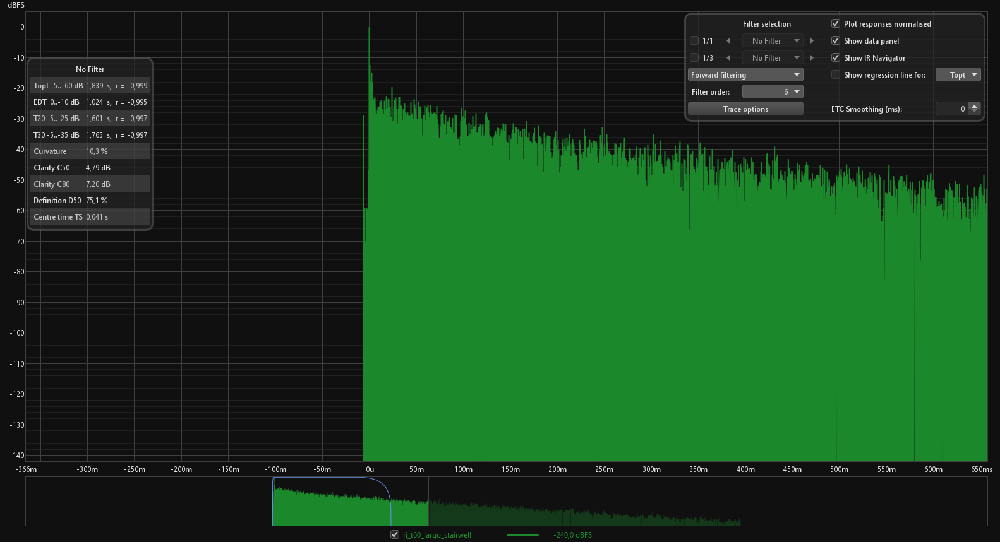
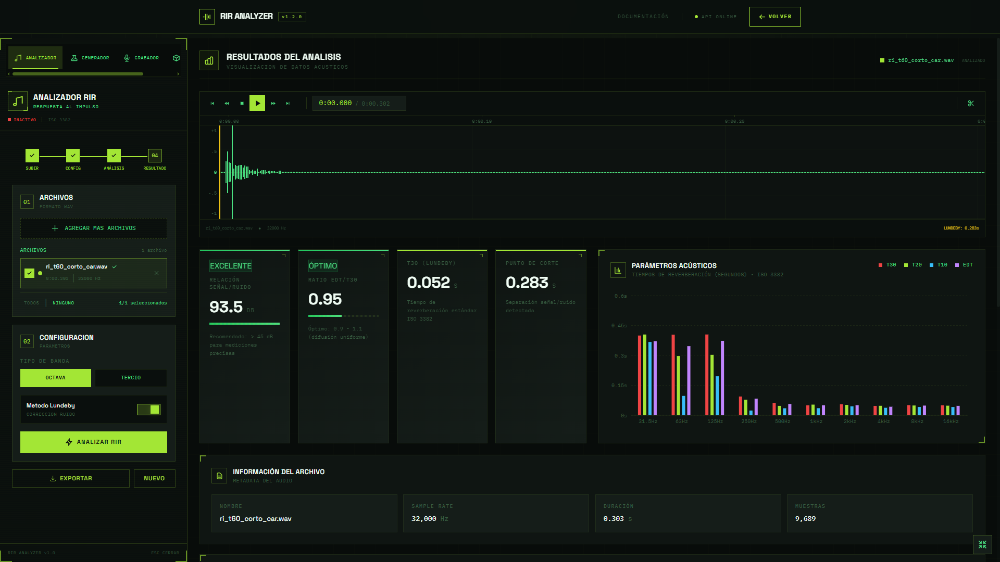
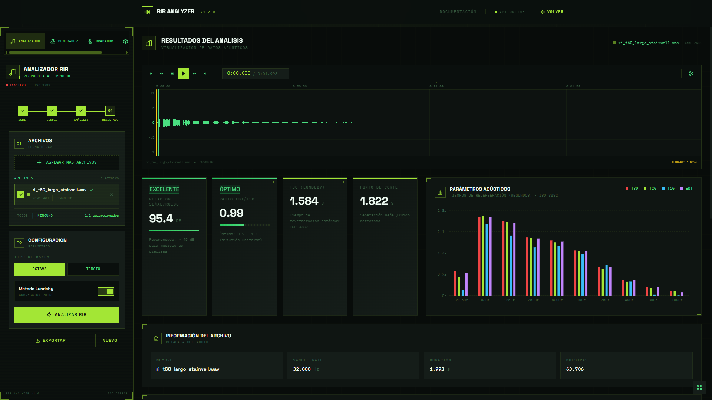

# Evidencias de validación — M2

## 1. Generación de respuesta al impulso sintética

Se generó una respuesta al impulso sintética utilizando `generate_synthetic_ir()`, con una frecuencia de muestreo de 44.100 Hz y un T60 objetivo de 0,8 segundos en la banda de 1.000 Hz.

Para validar el tiempo de reverberación se filtró la señal en dicha banda y se calculó la integral de Schroeder. Luego se estimó el T60 mediante regresión lineal sobre el tramo comprendido entre -5 dB y -25 dB.

**Resultados:**
- T60 objetivo: 0,800 s.
- T60 estimado: 0,844 s.
- Error relativo: 5,5 %.

El resultado presenta una buena concordancia con el valor configurado.

## 2. Recuperación de la respuesta al impulso mediante deconvolución

Se generó una respuesta al impulso de referencia y un barrido senoidal (*sine sweep*) de 2 segundos, entre 20 Hz y 20.000 Hz, utilizando `generate_sine_sweep_pair()`.

Se simuló la grabación del barrido al atravesar un sistema cuya respuesta al impulso era conocida, mediante una convolución. Posteriormente, se aplicó el filtro inverso utilizando `get_impulse_response()` para recuperar la respuesta al impulso.

Se compararon ambas señales mediante el coeficiente de correlación.

**Resultado:**
- Correlación entre la RI original y la recuperada: 1,0000.

La correlación obtenida demuestra una coincidencia prácticamente perfecta entre ambas respuestas en esta simulación.

## 3. Validación del filtro de banda de octava IEC 61260

Se evaluó la respuesta en frecuencia de `filter_single_band()` utilizando un filtro centrado en 1.000 Hz, con frecuencia de muestreo de 44.100 Hz.

Para obtener la respuesta se aplicó el filtro a un impulso unitario y se calculó su transformada rápida de Fourier (FFT). La magnitud se normalizó y se expresó en decibeles.

**Resultados obtenidos:**

| Frecuencia | Ganancia |
|---:|---:|
| 500 Hz | -52,21 dB |
| 707,11 Hz | -6,02 dB |
| 1.000 Hz | 0,00 dB |
| 1.414,21 Hz | -6,02 dB |
| 2.000 Hz | -52,55 dB |

La respuesta presenta una ganancia máxima en la frecuencia central, una atenuación de aproximadamente 6 dB en los límites de la banda y una atenuación superior a 50 dB en las frecuencias adyacentes.

La atenuación de aproximadamente 6 dB en los límites se debe a la aplicación del filtro en ambos sentidos mediante `sosfiltfilt()`.

## 4. Validación con respuestas al impulso reales — caso de T60 corto

Se incorporó una respuesta al impulso real del conjunto **MIT IR Survey**, elegida como ejemplo de decaimiento corto:

- Archivo: `docs/m2/audio/ri_t60_corto_car.wav`
- Archivo original: `h011_Car_29txts.wav`
- Frecuencia de muestreo: 32.000 Hz
- Duración: 0,303 s
- Caso representativo: habitáculo de auto
- RT60 estimado mediante T20 (-5 dB a -25 dB): 0,056 s
- R² del ajuste lineal: 0,993

La señal fue cargada con `load_audio()` para verificar que el servicio pudiera leer correctamente una RI real en formato WAV, conservar la frecuencia de muestreo y devolver una señal mono normalizada.

Además, se generó una figura de validación que incluye la forma de onda, el espectro y el decaimiento energético en dB por bandas de octava.

## 5. Validación con respuestas al impulso reales — caso de T60 largo

Se incorporó también una respuesta al impulso real del mismo conjunto, elegida como ejemplo de decaimiento largo:

- Archivo: `docs/m2/audio/ri_t60_largo_stairwell.wav`
- Archivo original: `h256_Stairwell_1txts.wav`
- Frecuencia de muestreo: 32.000 Hz
- Duración: 1,993 s
- Caso representativo: escalera / stairwell
- RT60 estimado mediante T20 (-5 dB a -25 dB): 1,626 s
- R² del ajuste lineal: 0,995

Este caso permite contrastar el comportamiento del procesamiento frente a una RI con reverberación mucho más prolongada. Al igual que en el caso anterior, la señal fue cargada con `load_audio()` y luego representada gráficamente mediante su forma de onda, espectro y decaimiento energético en dB por bandas de octava.

## 6. Comparación con Room EQ Wizard (REW)

Para validar externamente los resultados obtenidos por el código del proyecto, las mismas dos respuestas al impulso reales fueron importadas en Room EQ Wizard (REW).

Se utilizó el parámetro T20, calculado sobre el intervalo de decaimiento comprendido entre -5 dB y -25 dB, de forma equivalente al procedimiento implementado en `scripts/generate_m2_evidence.py`.

| Respuesta al impulso | T20 proyecto | T20 REW | Diferencia aproximada |
|---|---:|---:|---:|
| Auto — T60 corto | 0,056 s | 0,052 s | 7,1 % |
| Stairwell — T60 largo | 1,626 s | 1,601 s | 1,5 % |

### RI de T60 corto

REW estimó:

- T20: 0,052 s
- Coeficiente de correlación del ajuste: r = -0,996
- T30: 0,056 s
- Coeficiente de correlación del ajuste T30: r = -0,998

El resultado presenta una buena concordancia con el T20 de 0,056 s obtenido mediante el código del proyecto.

### RI de T60 largo

REW estimó:

- T20: 1,601 s
- Coeficiente de correlación del ajuste: r = -0,997
- T30: 1,765 s
- Coeficiente de correlación del ajuste T30: r = -0,997

El T20 obtenido por REW difiere aproximadamente un 1,5 % respecto de los 1,626 s calculados por el proyecto, mostrando una concordancia muy buena entre ambas implementaciones.

## 7. Validación en el frontend RIR Analyzer

Las mismas dos respuestas al impulso reales fueron procesadas también con el frontend RIR Analyzer de la cátedra utilizando bandas de octava y el método de corrección de ruido Lundeby.

### RI de T60 corto

Para `ri_t60_corto_car.wav`, el frontend obtuvo:

- Relación señal/ruido: 93,5 dB
- Ratio EDT/T30: 0,95
- T30 (Lundeby): 0,052 s
- Punto de corte Lundeby: 0,283 s

El resultado es consistente con los valores obtenidos previamente mediante el código del proyecto y REW.

### RI de T60 largo

Para `ri_t60_largo_stairwell.wav`, el frontend obtuvo:

- Relación señal/ruido: 95,4 dB
- Ratio EDT/T30: 0,99
- T30 (Lundeby): 1,584 s
- Punto de corte Lundeby: 1,822 s

El valor obtenido se encuentra en el mismo orden que las estimaciones realizadas con el código del proyecto y con REW. Las diferencias son esperables debido al uso del método Lundeby y a que las estimaciones no utilizan exactamente el mismo intervalo de decaimiento.

