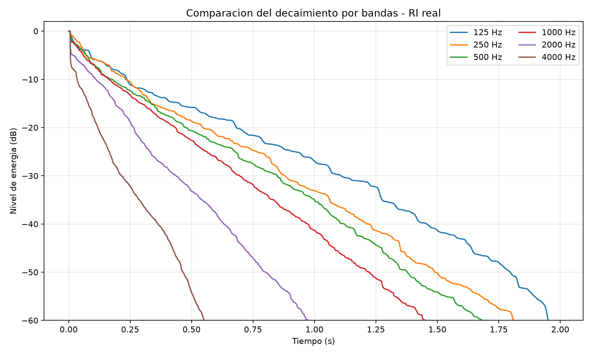
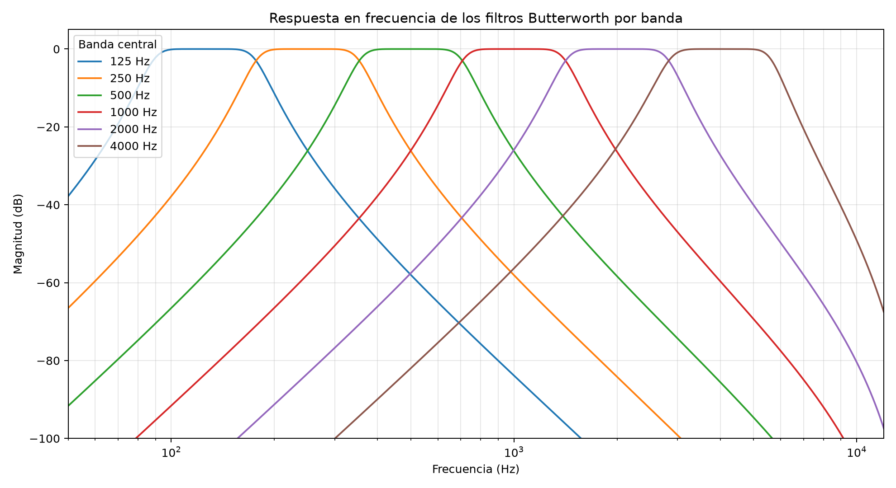
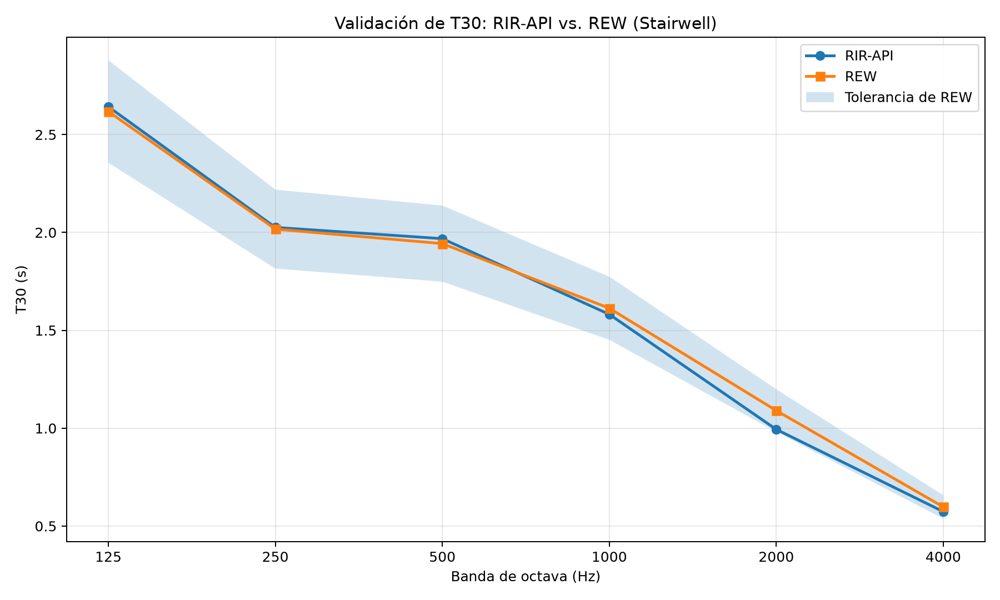

# M3 — Evidencia de procesamiento y validación

## 1. Objetivo

Documentar y evaluar el funcionamiento de los algoritmos de procesamiento acústico según ISO 3382 implementados en RIR-API durante el Milestone 3 (`apply_smoothing`, `apply_schroeder_integral`, `linear_regression` y `calculate_parameters_from_ir`).

Se presentan resultados obtenidos a partir de una respuesta impulsiva sintética, cuyos tiempos de reverberación son conocidos, y una respuesta impulsiva real correspondiente a una escalera (`ri_t60_largo_stairwell.wav`).

## 2. Metodología

Se utilizaron dos respuestas impulsivas con frecuencia de muestreo de 32 kHz:

- **Señal sintética:** generada mediante `generate_synthetic_ir`, con frecuencia de muestreo de 32 kHz y duración de 4,5 segundos:

| Banda (Hz) | T60 objetivo (s) |
|---:|---:|
| 125 | 1,80 |
| 250 | 1,70 |
| 500 | 1,60 |
| 1000 | 1,50 |
| 2000 | 1,30 |
| 4000 | 1,10 |

- **Señal real:** respuesta impulsiva de una escalera almacenada en `docs/m2/audio/ri_t60_largo_stairwell.wav` (32 kHz).

Para ambas señales se calcularon EDT, T10, T20, T30, D50 y C80 en las seis bandas de octava consideradas. El procesamiento incluye normalización del inicio de la RI (pre-trigger de 5 ms), filtrado por bandas, integración inversa de Schroeder, verificación de rango dinámico y regresión lineal.

## 3. Evidencia gráfica

### 3.1. Curva de Schroeder y regresión lineal

Resultados del ajuste entre -5 y -35 dB:

- **Pendiente de regresión:** -35,0238 dB/s
- **Intercepto:** registrado en `validacion_schroeder.csv`
- **Coeficiente de determinación:** R² = 0,99618

### 3.2. Comparación del decaimiento por bandas — señal sintética

### 3.3. Comparación del decaimiento por bandas — señal real

### 3.4. Comparación de filtros por banda de octava

Se representa la respuesta en frecuencia normalizada de los filtros correspondientes a las bandas de octava de 125, 250, 500, 1000, 2000 y 4000 Hz.

La gráfica permite visualizar las bandas de paso y la atenuación fuera de cada banda, utilizadas para separar las componentes frecuenciales de las respuestas al impulso.

### 3.5. Validación de T30 frente a REW

Se presenta la comparación de T30 entre RIR-API y REW para la respuesta al impulso real Stairwell.

La zona sombreada representa la tolerancia de aceptación aplicada a cada banda.

En las seis bandas evaluadas, las diferencias de T30 se encuentran dentro de la tolerancia establecida para M3.

Esta gráfica ilustra exclusivamente la validación de T30 frente a REW. Los resultados numéricos actualizados y las comparaciones completas de EDT, T20, T30 y C80 se documentan en la sección 5.

## 4. Validación de la señal sintética

| Banda (Hz) | T60 objetivo (s) | T30 calculado (s) | Error relativo |
|---:|---:|---:|---:|
| 125 | 1,80 | 1,896 | 5,3 % |
| 250 | 1,70 | 1,748 | 2,8 % |
| 500 | 1,60 | 1,573 | 1,7 % |
| 1000 | 1,50 | 1,527 | 1,8 % |
| 2000 | 1,30 | 1,306 | 0,5 % |
| 4000 | 1,10 | 1,101 | 0,1 % |

Los resultados completos de todos los parámetros (`EDT`, `T10`, `T20`, `T30`, `D50`, `C80`) para la señal sintética y para la escalera real se encuentran en `docs/m3/resultados_parametros.csv`.

## 5. Contraste profesional con REW y ARTA (17/11/2026)

### 5.1 Alcance y metodología

Se contrastó la función `calculate_parameters_from_ir` con software de análisis acústico profesional para dos respuestas al impulso reales: **Stairwell**, `docs/m2/audio/ri_t60_largo_stairwell.wav` (32 kHz), frente a **REW**; y **Reactor R1**, `docs/m3/audio/r1_omni_48k.wav` (48 kHz), frente a **ARTA**.

Se evaluaron EDT, T20, T30 y C80 en las seis bandas de octava de 125 a 4000 Hz.
Los valores de referencia de REW proceden de la columna `REW` de `docs/m3/comparacion_rew.csv`; los de ARTA, del archivo `docs/m3/arta_r1_omni_48k.csv`.

El archivo `comparacion_rew.csv` contiene los valores actuales de RIR-API, las diferencias absolutas y relativas y la verificación de las tolerancias correspondientes. La columna `REW` conserva los valores de referencia utilizados en la comparación original.

Para EDT, T20 y T30 se aplicó una tolerancia absoluta igual a `min(0.1 × |referencia|, 0.5 s)`. Para C80 se utilizó ±1 dB. Se computó el error absoluto en cada banda. **Un resultado dentro de tolerancia no equivale a identidad metodológica** entre programas.

En la versión final integrada en `main`, D50 y C80 utilizan un mismo índice de referencia temporal, determinado por el máximo absoluto de la RI broadband luego de conservar un pretrigger de 5 ms. Los tiempos de decaimiento usan filtrado por banda, integración inversa de Schroeder y regresión lineal. La comparación con REW y ARTA corresponde a la versión final del código integrada en los PR #94 y #96.

### 5.2 Resultado global

| Conjunto | EDT | T20 | T30 | C80 | Total |
|---|---:|---:|---:|---:|---:|
| Stairwell / REW | 5/6 | 6/6 | 6/6 | 4/6 | **21/24** |
| Reactor R1 / ARTA | 5/6 | 6/6 | 6/6 | 6/6 | **23/24** |
| **Total** | **10/12** | **12/12** | **12/12** | **10/12** | **44/48** |

### 5.3 Detalle por banda

#### Stairwell / REW

| Parámetro | Banda (Hz) | RIR-API | Referencia | Error absoluto | Tolerancia | Cumple |
|---|---:|---:|---:|---:|---:|:---:|
| EDT | 125 | 1.749 s | 1.783 s | 0.034 s | 0.178 s | Sí |
| EDT | 250 | 1.526 s | 1.456 s | 0.070 s | 0.146 s | Sí |
| EDT | 500 | 1.085 s | 1.174 s | 0.089 s | 0.117 s | Sí |
| EDT | 1000 | 1.075 s | 1.129 s | 0.054 s | 0.113 s | Sí |
| EDT | 2000 | 0.936 s | 1.026 s | 0.090 s | 0.103 s | Sí |
| EDT | 4000 | 0.237 s | 0.497 s | 0.260 s | 0.050 s | **No** |
| T20 | 125 | 2.604 s | 2.596 s | 0.008 s | 0.260 s | Sí |
| T20 | 250 | 2.009 s | 1.974 s | 0.035 s | 0.197 s | Sí |
| T20 | 500 | 1.890 s | 1.894 s | 0.004 s | 0.189 s | Sí |
| T20 | 1000 | 1.545 s | 1.570 s | 0.025 s | 0.157 s | Sí |
| T20 | 2000 | 0.924 s | 0.962 s | 0.038 s | 0.096 s | Sí |
| T20 | 4000 | 0.505 s | 0.531 s | 0.026 s | 0.053 s | Sí |
| T30 | 125 | 2.642 s | 2.618 s | 0.024 s | 0.262 s | Sí |
| T30 | 250 | 2.026 s | 2.017 s | 0.009 s | 0.202 s | Sí |
| T30 | 500 | 1.968 s | 1.943 s | 0.025 s | 0.194 s | Sí |
| T30 | 1000 | 1.582 s | 1.613 s | 0.031 s | 0.161 s | Sí |
| T30 | 2000 | 0.994 s | 1.090 s | 0.096 s | 0.109 s | Sí |
| T30 | 4000 | 0.574 s | 0.598 s | 0.024 s | 0.060 s | Sí |
| C80 | 125 | 2.021 dB | 2.700 dB | 0.679 dB | 1.000 dB | Sí |
| C80 | 250 | 3.407 dB | 4.630 dB | 1.223 dB | 1.000 dB | **No** |
| C80 | 500 | 4.569 dB | 5.320 dB | 0.751 dB | 1.000 dB | Sí |
| C80 | 1000 | 4.604 dB | 5.180 dB | 0.576 dB | 1.000 dB | Sí |
| C80 | 2000 | 6.075 dB | 7.710 dB | 1.635 dB | 1.000 dB | **No** |
| C80 | 4000 | 14.653 dB | 15.500 dB | 0.847 dB | 1.000 dB | Sí |

**Resultado:** 21/24 comparaciones dentro de tolerancia.

#### Reactor R1 / ARTA

| Parámetro | Banda (Hz) | RIR-API | Referencia | Error absoluto | Tolerancia | Cumple |
|---|---:|---:|---:|---:|---:|:---:|
| EDT | 125 | 3.779 s | 3.936 s | 0.157 s | 0.394 s | Sí |
| EDT | 250 | 4.388 s | 4.875 s | 0.487 s | 0.488 s | Sí |
| EDT | 500 | 4.459 s | 4.556 s | 0.097 s | 0.456 s | Sí |
| EDT | 1000 | 4.164 s | 4.338 s | 0.174 s | 0.434 s | Sí |
| EDT | 2000 | 2.952 s | 3.128 s | 0.176 s | 0.313 s | Sí |
| EDT | 4000 | 1.841 s | 2.143 s | 0.302 s | 0.214 s | **No** |
| T20 | 125 | 4.044 s | 4.117 s | 0.073 s | 0.412 s | Sí |
| T20 | 250 | 4.876 s | 4.920 s | 0.044 s | 0.492 s | Sí |
| T20 | 500 | 5.332 s | 5.319 s | 0.013 s | 0.500 s | Sí |
| T20 | 1000 | 4.775 s | 4.781 s | 0.006 s | 0.478 s | Sí |
| T20 | 2000 | 3.440 s | 3.477 s | 0.037 s | 0.348 s | Sí |
| T20 | 4000 | 2.328 s | 2.374 s | 0.046 s | 0.237 s | Sí |
| T30 | 125 | 4.429 s | 4.497 s | 0.068 s | 0.450 s | Sí |
| T30 | 250 | 5.097 s | 5.137 s | 0.040 s | 0.500 s | Sí |
| T30 | 500 | 5.457 s | 5.432 s | 0.025 s | 0.500 s | Sí |
| T30 | 1000 | 4.757 s | 4.776 s | 0.019 s | 0.478 s | Sí |
| T30 | 2000 | 3.528 s | 3.586 s | 0.058 s | 0.359 s | Sí |
| T30 | 4000 | 2.410 s | 2.490 s | 0.080 s | 0.249 s | Sí |
| C80 | 125 | -4.623 dB | -4.530 dB | 0.093 dB | 1.000 dB | Sí |
| C80 | 250 | -1.173 dB | -1.120 dB | 0.053 dB | 1.000 dB | Sí |
| C80 | 500 | -3.619 dB | -3.560 dB | 0.059 dB | 1.000 dB | Sí |
| C80 | 1000 | -3.366 dB | -3.250 dB | 0.116 dB | 1.000 dB | Sí |
| C80 | 2000 | -0.125 dB | -0.040 dB | 0.085 dB | 1.000 dB | Sí |
| C80 | 4000 | 2.041 dB | 2.070 dB | 0.029 dB | 1.000 dB | Sí |

**Resultado:** 23/24 comparaciones dentro de tolerancia.

### 5.4 Discrepancias y pruebas de sensibilidad

| Conjunto | Caso | Diferencia | Tolerancia |
|---|---|---:|---:|
| Stairwell / REW | EDT, 4000 Hz | 0,260 s | 0,050 s |
| Stairwell / REW | C80, 250 Hz | 1,223 dB | 1,000 dB |
| Stairwell / REW | C80, 2000 Hz | 1,635 dB | 1,000 dB |
| Reactor R1 / ARTA | EDT, 4000 Hz | 0,302 s | 0,214 s |

- **EDT a 4000 Hz:** variar el orden de Butterworth de 4 a 6 apenas modificó los valores (Stairwell: 0,237 a 0,239 s; Reactor R1: 1,841 a 1,837 s). Para Stairwell, el ajuste entre 0 y −10 dB presentó `R² ≈ 0,655`, lo que señala una curva inicial poco lineal; para Reactor R1, `R² ≈ 0,970`. Se observaron pendientes diferentes en 0 a −5 dB y −5 a −10 dB. Estos hallazgos no prueban por sí solos la causa de la discrepancia.
- **C80 en Stairwell:** adelantar exploratoriamente el comienzo de integración 2 ms permitió 6/6 bandas dentro de ±1 dB (error medio 0,415 dB, frente a 0,952 dB del método actual), pero **no se implementó** por falta de justificación de ese origen temporal. La detección exploratoria del inicio con umbrales de −20, −25 y −30 dB localizó candidatos solo unos 0,062 ms antes del pico y no resolvió las discrepancias.
- **Orden de división y filtrado:** la variante experimental de segmentar en ventanas temporales antes de filtrar dio 5/6 bandas conformes en Stairwell, pero aumentó su error medio a 0,985 dB y empeoró el error a 2000 Hz (2,019 dB). En Reactor R1 se mantuvo 6/6, con error medio 0,082 dB, frente a 0,072 dB del método actual. La prueba no constituye una implementación normativa completa y no justifica un cambio de producción.
- **Comparación directa C80 con ARTA (Reactor R1):** las seis bandas coincidieron entre el cálculo independiente broadband y la función de la API dentro de la tolerancia numérica; el error máximo respecto de ARTA fue 0,116 dB.

### 5.5 Limitaciones y trazabilidad

- La comparación profesional de este apartado cubre **EDT, T20, T30 y C80**; no incluye una comparación externa de D50 y T10, aunque ambos están calculados en `resultados_parametros.csv`. El CSV sintético y el de Stairwell contienen 72 valores y pasaron auditoría interna de coherencia con la API (72/72, umbral de discrepancia `1e-6`).
- Los resultados profesionales se transcriben redondeados a tres decimales desde la ejecución de `tmp_m3_comparacion_actual.py` del 17/11/2026. Los errores y tolerancias mostrados también se redondean; una decisión cerca del umbral debe corroborarse con los valores sin redondear.
- Las cuatro discrepancias se declaran explícitamente; **no se presentan como aprobadas**. El objetivo de las pruebas de sensibilidad fue investigar causas, no optimizar cifras contra un software de referencia.
- Los gráficos de `docs/m3/images/` documentan aspectos específicos del procesamiento y la validación. En particular, `validacion_vs_rew_t30.png` representa la comparación de T30 frente a REW y no el conjunto completo de 48 resultados, que se encuentra documentado en las tablas de esta sección.

### 5.6 Conclusión

Los tiempos T20 y T30 cumplen el criterio establecido en las 24 comparaciones entre ambos conjuntos; C80 coincide muy bien con ARTA en Reactor R1. Permanecen cuatro discrepancias fuera de tolerancia, principalmente relacionadas con EDT a 4000 Hz y la sensibilidad temporal de C80 en Stairwell. No se efectuaron modificaciones experimentales del algoritmo para forzar conformidad. La documentación de entrega debe distinguir estas limitaciones del comportamiento validado.
