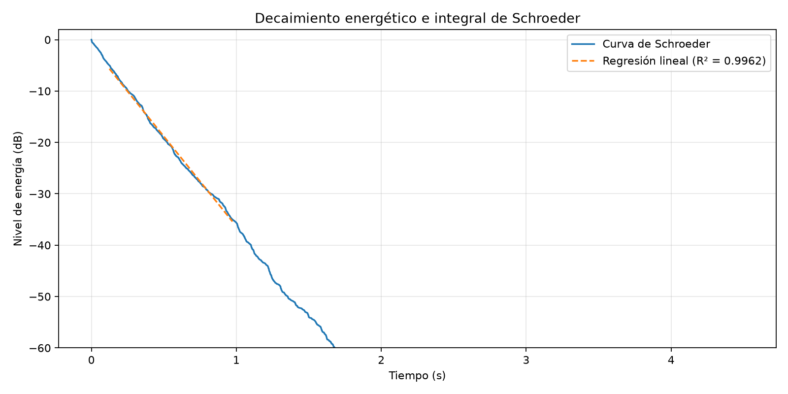
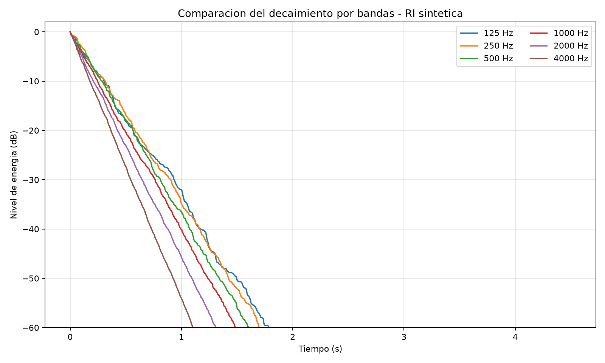

# M3 — Evidencia de procesamiento y validación

## 1. Objetivo

Documentar y evaluar el funcionamiento de los algoritmos de procesamiento acústico según ISO 3382 implementados en RIR-API durante el Milestone 3 (`apply_smoothing`, `apply_schroeder_integral`, `linear_regression` y `calculate_parameters_from_ir`).

Se presentan resultados obtenidos a partir de una respuesta impulsiva sintética, cuyos tiempos de reverberación son conocidos, y una respuesta impulsiva real correspondiente a una escalera (`ri_t60_largo_stairwell.wav`).

## 2. Metodología

Se utilizaron dos respuestas impulsivas con frecuencia de muestreo de 32 kHz:

- **Señal sintética:** generada mediante `generate_synthetic_ir`, con frecuencia de muestreo de 32 kHz y duración de 4,5 segundos:

| Banda (Hz) | T60 objetivo (s) |
|---:|---:|
| 125 | 1,80 |
| 250 | 1,70 |
| 500 | 1,60 |
| 1000 | 1,50 |
| 2000 | 1,30 |
| 4000 | 1,10 |

- **Señal real:** respuesta impulsiva de una escalera almacenada en `docs/m2/audio/ri_t60_largo_stairwell.wav` (32 kHz).

Para ambas señales se calcularon EDT, T10, T20, T30, D50 y C80 en las seis bandas de octava consideradas. El procesamiento incluye normalización del inicio de la RI (pre-trigger de 5 ms), filtrado por bandas, integración inversa de Schroeder, verificación de rango dinámico y regresión lineal.

## 3. Evidencia gráfica

### 3.1. Curva de Schroeder y regresión lineal

Resultados del ajuste entre -5 y -35 dB:

- **Pendiente:** -35,0238 dB/s
- **Intercepto:** registrado en `validacion_schroeder.csv`
- **Coeficiente de determinación:** R² = 0,99618

### 3.2. Comparación del decaimiento por bandas — señal sintética

### 3.3. Comparación del decaimiento por bandas — señal real

## 4. Validación de la señal sintética

| Banda (Hz) | T60 objetivo (s) | T30 calculado (s) | Error relativo |
|---:|---:|---:|---:|
| 125 | 1,80 | 1,896 | 5,3 % |
| 250 | 1,70 | 1,748 | 2,8 % |
| 500 | 1,60 | 1,573 | 1,7 % |
| 1000 | 1,50 | 1,527 | 1,8 % |
| 2000 | 1,30 | 1,306 | 0,5 % |
| 4000 | 1,10 | 1,101 | 0,1 % |

Los resultados completos de todos los parámetros (`EDT`, `T10`, `T20`, `T30`, `D50`, `C80`) para la señal sintética y para la escalera real se encuentran en `docs/m3/resultados_parametros.csv`.
